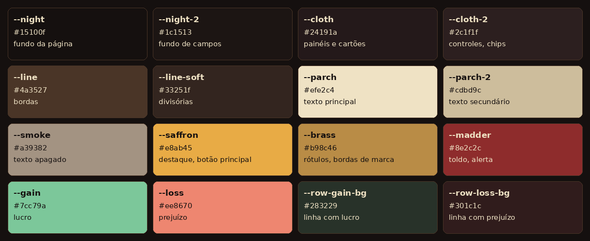

# Identidade visual do Balcão de Negócios do Fumaça e do Albion Overlay

Este guia vale para o site, para o overlay (programa Windows) e para qualquer página ou janela nova. Quando algo aqui e o código discordarem, o certo é o que está aqui: corrija o código.

**Conceito:** uma barraca de mercado (souk) à noite. Tecido escuro, pergaminho, toldo listrado, lanterna acesa. O destaque é o **açafrão**; o resto fica quieto.

---

## 1. Logos

| Arquivo | Onde aparece | Desenho |
|---|---|---|
| `logo-site.svg` | Marca do site, no topo, ao lado de "Balcão de Negócios do **Fumaça**" | Lanterna: corpo marrom `#3a2614` com contorno latão `#b98c46`, vidro açafrão `#e8ab45`, estrela de quatro pontas no vidro, argola e base em latão. |
| `favicon.svg` | Aba do navegador | Estrela de quatro pontas açafrão `#e8ab45`. |
| `icone-overlay.ico`, `icone-overlay-128.png`, `icone-overlay-16.png` | Ícone do Albion Overlay: `.exe`, bandeja, janelas e avisos do programa | Escudo com borda dourada, toldo listrado vermelho e creme no alto, a mesma lanterna no centro. Arte original, sem nada do jogo. A fonte é `icone-arte/draw.py`, no código do programa. |

Regras dos logos:
- Não trocar as cores, não esticar, não pôr sombra nem brilho.
- Sobre fundo claro, usar o ícone do overlay (o escudo já traz o próprio fundo). A lanterna solta só vai sobre fundo escuro (`--night` ou `--cloth`).
- No site, o nome é "Balcão de Negócios do" em texto pequeno e "Fumaça" em El Messiri açafrão, com as três fumacinhas animadas.

---

## 2. Cores

Use sempre as variáveis (`var(--saffron)`), nunca o código da cor solto.

| Variável | Cor | Uso |
|---|---|---|
| `--night` | `#15100f` | Fundo da página e da bandeja |
| `--night-2` | `#1c1513` | Fundo de campos e áreas internas |
| `--cloth` | `#24191a` | Painéis, cartões, janelas |
| `--cloth-2` | `#2c1f1f` | Controles (campos, listas, chips), segmento escolhido |
| `--line` | `#4a3527` | Bordas de painéis e janelas |
| `--line-soft` | `#33251f` | Divisórias e bordas de controles |
| `--parch` | `#efe2c4` | Texto principal e títulos de janelas |
| `--parch-2` | `#cdbd9c` | Texto secundário e rótulos de campos |
| `--smoke` | `#a39382` | Texto apagado, legendas, "sem dados" |
| `--saffron` | `#e8ab45` | Destaque: botão principal, item ativo, valor em destaque, foco |
| `--saffron-ink` | `#1d1206` | Texto sobre fundo açafrão |
| `--brass` | `#b98c46` | Títulos de seção pequenos, bordas da marca, chip escolhido |
| `--madder` | `#8e2c2c` | Toldo listrado, alertas |
| `--gain` | `#7cc79a` | Lucro, "ok", spec atingida |
| `--loss` | `#ee8670` | Prejuízo, erro |

**Linhas de lucro e prejuízo** (tabelas e listas de todas as abas):

| Variável | Cor | Uso |
|---|---|---|
| `--row-gain-bg` | `#283229` | Fundo da linha com lucro (verde discreto) |
| `--row-gain-hover` | `#2a3c2f` | Lucro, com o mouse em cima |
| `--row-loss-bg` | `#301c1c` | Fundo da linha com prejuízo |
| `--row-loss-hover` | `#3b2121` | Prejuízo, com o mouse em cima |
| Filete à esquerda | `--gain` / `--loss` | 3 px |

Sem dado: fundo `--cloth`.

**Cores do jogo** (só onde representam algo do Albion):
- Tier dos mapas de Avalon: T4 `#8fd19a`, T6 `#e6c56a`, T8 `#e58b6a`. O selo leva a cor no texto, um fundo com 18% dela e a borda com 55%.
- Tipo de mapa de Avalon: Low/Medium/High Black `#000`, Royal azul `#1d4ea8`, Royal vermelho `#c4161c`, Tunnel `#5b3a1c`, Hideout `#5a2b86`. Texto branco.
- Dungeons e baús: solo `#a8283c`, grupo `#9a5420`, raid `#7b45b8`, hideout `#5a2b86`, Brecilien `#1f7a62`, baú azul `#1d6fd6`, baú verde `#2e8b3d`, baú dourado `#c9a227` (texto escuro).

---

## 3. Letras

| Família | Papel | Pesos |
|---|---|---|
| **El Messiri** | Títulos, nome da marca, números grandes de destaque (total, lucro do topo) | 500, 600, 700 |
| **Alegreya Sans** | Todo o resto: texto, rótulos, botões, campos, tabelas | 400, 500, 700 |

Reserva no CSS: `--f-display: "El Messiri", "Palatino Linotype", Georgia, serif` e `--f-body: "Alegreya Sans", "Gill Sans", "Segoe UI", system-ui, sans-serif`.

Escala:
- Título de página: 26 a 32 px, El Messiri 600.
- Título de janela: 22 a 24 px, El Messiri 600 ou 700, cor `--parch`.
- Título de seção pequeno: 13 px, Alegreya Sans 600, cor `--brass`.
- Texto: 15 a 17 px, Alegreya Sans 400 ou 500.
- Rótulo de campo: 13 a 14 px, 600, `--parch-2`, em cima do campo.
- Legenda: 12 px, `--smoke`.

Regras:
- **Nada de MAIÚSCULAS forçadas** (`text-transform: uppercase`). Rótulos e cabeçalhos ficam em caixa de frase: "Qualidade", "Méd. 7d".
- Sem fonte de código em dado: `monospace` só em caixas de código ou texto colado.
- Números de colunas com `font-variant-numeric: tabular-nums`, alinhados à direita.
- Exceção: o menu do ícone da bandeja é desenhado pelo Windows e não carrega fontes da web. Ele usa **Segoe UI**, com as cores da identidade.

---

## 4. Números e texto

- **Valores no formato do Albion:** abaixo de mil, o número inteiro sem ponto (`735`). De mil para cima, uma casa decimal e K = mil, M = milhão, B = bilhão: `8,4K`, `20,4M`, `1,3B`. Nunca `20.400.000`.
- Ficam de fora porcentagens (`52,3%`), versões (`32.040.1`) e nível de spec (`1006/1200`).
- Português do Brasil, em frase normal, sem exclamações. Botões dizem a ação: "Copiar para o Albion", "Iniciar com o Windows", "Limpar filtros".
- Vazio e erro dizem o que fazer: "Sem ofertas recentes.", "Não achei o mapa X na lista de Avalon."

---

## 5. Formas e componentes

Medidas: `--ctl-h: 40px` (campos e botões), `--chip-h: 32px`, `--r-ctl: 8px` (cantos de controles), `--r-panel: 12px` (cantos de painéis). As janelas usam 14 px.

| Componente | Como é |
|---|---|
| **Painel / cartão** | `--cloth`, borda 1 px `--line` (ou `--line-soft` dentro de outro painel), raio 12. Sem degradê, sem brilho. Com lucro, ganha o verde discreto da linha. |
| **Botão principal** | Fundo `--saffron`, texto `--saffron-ink`, 700. Um só por tela ou janela. |
| **Botão secundário** | Fundo `--cloth-2` ou transparente, borda `--line`, texto `--parch`. No hover e no foco, a borda vai para `--saffron` ou `--brass`. |
| **Segmento** (Venda/Compra, tiers) | Botões de largura igual, fundo `--cloth-2`; o escolhido ganha texto `--parch` e um **sublinhado açafrão** de 2 px (`box-shadow: inset 0 -2px 0 var(--saffron)`). Nunca preencher de amarelo. |
| **Chips de filtro** | 32 px de altura; o escolhido fica em `--brass`. Listas longas viram **múltipla escolha** com busca (componente `msel`). |
| **Filtros** | Rótulo em cima, controles de 40 px. Os menos usados vão em "Mais filtros", que mostra quantos estão ativos. Em tela de até 700 px, a barra recolhe atrás do botão "Filtros". |
| **Tabelas e listas** | Cabeçalho fixo ao rolar, em caixa de frase. Linhas de lucro e prejuízo como na seção 2. Colunas numéricas à direita. |
| **Selos** (tier, tipo, dungeon) | Pílula arredondada (999 px), 700, nas cores do jogo da seção 2. Quantidade dentro do selo: `×3`. |
| **Quantidade em destaque** | Caixinha `--saffron` com texto `--saffron-ink`: `×12`. |
| **Janela (diálogo)** | `--cloth`, borda `--line`, raio 14, sombra `0 14px 40px rgba(0,0,0,.5)`. Título em El Messiri `--parch`. Nas janelas do overlay, o toldo listrado no topo (7 px, `--madder` e `--parch` em faixas de 26 px) e o ícone do escudo ao lado do título. |
| **Barra de carregamento** | Faixa açafrão sobre `--night-2`, com o texto do que está sendo consultado e a contagem (`6300 de 10067 itens · 63%`). Obrigatória em consulta pesada. |
| **Foco** | Contorno 2 px `--saffron`, afastado 2 px. Nunca remover sem pôr outro no lugar. |

**Onde pode haver degradê:** só nos elementos de marca, ou seja, a barra do topo com o toldo listrado, o item ativo da barra lateral (filete açafrão) e a barra de carregamento. Em cartões, janelas e botões, cor lisa.

---

## 6. Overlay (programa Windows)

- A barra lateral e o topo repetem os do site: fundo escuro, ícones com rótulo em Alegreya Sans 13 px `--parch-2`, item ativo em açafrão.
- As janelinhas (pesquisa de item, mapa de Avalon, avisos, "Iniciar com o Windows", atualização) seguem a seção 5.
- O mapa de Avalon abre em paisagem (1100 × 680), igual à janela do site.
- O menu do ícone da bandeja é desenhado à mão: fundo `#15100f`, texto `#efe2c4`, apagado `#a39382`, item sob o mouse `#3a291c`, marca açafrão `#e8ab45`, divisória `#4a3527`, fonte Segoe UI.

---

## 7. Antes de publicar algo novo

- [ ] Só variáveis de cor; nenhum código de cor solto fora da seção 2.
- [ ] El Messiri em títulos, Alegreya Sans no resto; sem maiúsculas forçadas.
- [ ] Valores em K/M/B.
- [ ] Controles com 40 px, cantos de 8 e 12 px, sem degradê fora dos elementos de marca.
- [ ] Um botão principal só, segmento com sublinhado açafrão.
- [ ] Foco visível e funcionando no teclado.
- [ ] Testado no site e no overlay, em tela larga e estreita.
